# RS2QoL — ロマンシング サガ2 (Steam) 快適化 MOD

- もう**爆音で悩まない**ロマンシング サガ2。
- **キーコンフィグ可能**です。ゲームパッドもキーボードも。
- **ソフトウェアリセットがゲームパッド**でもキーボードでもできます。
- **ゲームの終了がゲームパッド**でもできます。
- **キーボードで Esc がキャンセル**になります。
- 戦闘コマンド中、**ゲームパッドの LB / RB で退却・防御**できます。
- マップの**羽カーソルをぐりぐり**動かせます。

Steam 版「ロマンシング サガ2」(スマートフォン版からの移植) の UI / UX の不便を直し、
ゲームパッド及びキーボードで快適に遊べるようにする BepInEx 5 プラグインです。
ゲーム本体のファイルは一切書き換えません。

## 作者より

### 作った理由

Steam 版のレビューを見ると、「ゲームそのものはとても良いのに操作性が悪い」という声が「おすすめしません」の側に並んでいます。
このゲームの面白さを正しく知ってほしいのに、会社がそのための努力を怠っているのではないか。そんな思いが「おすすめしません」の底にあるように感じました。
きちんと不満を言葉にするのは、きっとファンだから。不満は期待の表れで、あの評価は会社を責めているのではなく、「期待に応えてほしい」という願いなのだと受け取っています。

かくいう作者もスーパーファミコン版を現役で遊んだ世代でして、このゲームを自分がストレスなく楽しみたくて、そして今は AI の助けを借りれば自分の手で直せると思って、この MOD を作りました。

あくまでも個人的な印象ですが、本体のままでは、このゲームを正しく評価できる状態にないと思っています。
この MOD で操作性の壁が消えて、このゲームの面白さがそのまま伝わってくれたら嬉しいです。

作者はリメイク (リベンジオブザセブン) も買いましたが、こっちに戻ってきた組です。私もようやく楽しめそうです。

この MOD がきっかけで Steam 版のロマサガ2 がよく売れて、同じ境遇にあるゲームの UI / UX にもっと力が入るようになって、お客さんもスクエニも win-win になれたらいいな、という夢を見ています。

### 作るうえで気をつけたこと

- Steam の「おすすめしません」の評価にある操作性の不満は、すべて解決させる。
- 同じ評価にある「1993 年の SFC にできて 2017 年の PC にできないこと」も反映させる。
- スーファミ時代の雰囲気を再現しつつ、快適性を上げる。

なかでも、次の 3 つにはこだわりました。

- **ゲームパッドの操作でストレスを感じさせない。** 入力の取りこぼし、斜めで止まる、押したままで流れる、押しても反応しない (Bluetooth 仕様のものは除く) といった気持ち悪さを一つずつ取り除きました。
- **体験を損ねる倍速はしない。** 快適さのための倍速 (コマンド選択や移動) はしっかり効かせ、文字の点滅やキャラクターの動きまで速くなって興ざめしないようにしました。何もかも速いと雰囲気を味わえないので、速くする場所を調整できるようにしています。
- **MOD だからといって、UI に手を抜かない。** MOD の設定画面が「別のゲームの画面」や「設定のためだけの画面」になって、世界観から引き戻されることがないように気をつけました。どこでも大臣やどこでも体重計にキャラクターを置いたのは特にこだわった点で、作った自分が一番テンションが上がりました。

敵や味方の成長の速さ、税収の倍率といった調整は、やり込みや縛りプレイ、自分でバランスを組むことに面白みを見出す人向けに置いてあるものです。普通に遊ぶなら触らないほうが、ロマサガの醍醐味でもある理不尽感を楽しめると思います (既定は本体どおりです)。個人的に、実装するか最も悩んだのはここでした。ただ、今は「強くてニューゲーム」もあるのだから、どっちもどっちだと思い直して、実装に至りました。

### 動作確認した環境

- ゲームパッドは **Xbox ワイヤレス コントローラー (Series X|S 世代)** です。
  まず Bluetooth で接続して開発と確認を進め、Bluetooth で快適に遊べることを確かめたうえで、最後に **Xbox ワイヤレス アダプター** でも確認しました。
  有線 (USB) 接続では確認していません。
- ちなみに、同じ無線でも Bluetooth と Xbox ワイヤレス アダプターは別物で、つながりの良さ (遅延や取りこぼしの少なさ) はアダプターの方が上と言われています。
  同じ無線方式なのにわざわざ買う価値はあるようです。Bluetooth で引っかかりを感じる人は試してみてください。
- ゲームの進行はウォッチマンの巣の手前までです。それ以降で不具合があるかどうかは分かっていません。
- ファストトラベルはイベントの進行に関わるらしく、手を加えていません。

## 画面

説明文の操作はゲームパッドの既定の割り当て (LB / RB、Start など) で書いています。キーボードでは同じ機能のキーで同じ操作になります。
スクリーンショットはゲーム本体の画面です (MOD が足した窓や文字を含みます)。© SQUARE ENIX

<table>
<tr>
<td width="50%">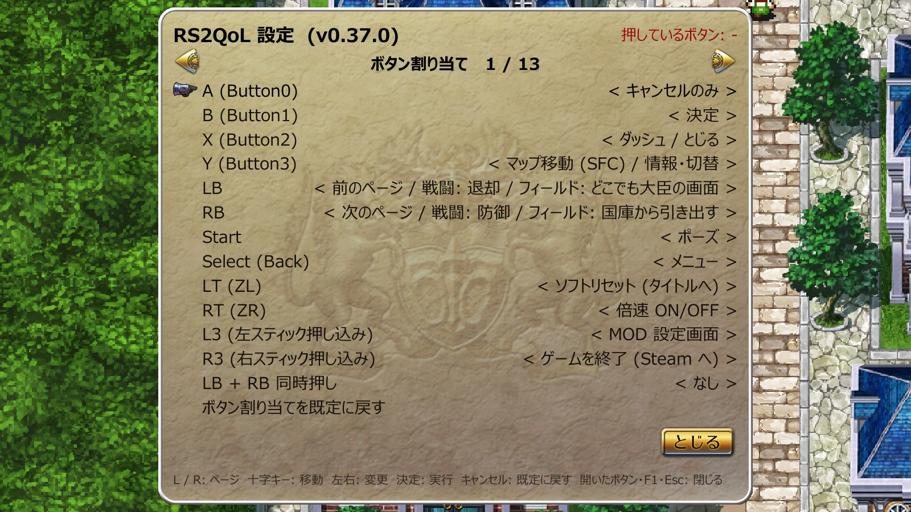 MOD 設定画面 (ボタン割り当て)。ゲーム本体の部品で描く 13 ページ</td>
<td width="50%">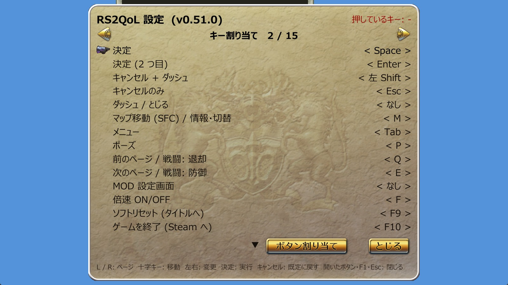 キー割り当て (キーボード)。既定は WASD 系 PC ゲームの配置</td>
</tr>
<tr>
<td>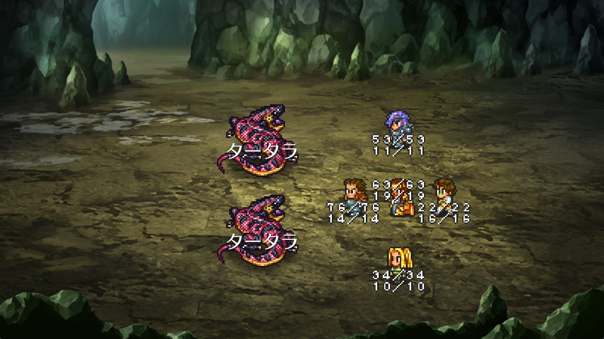 味方の HP / LP を「現在値/最大値」のドット文字で。絵の大きさは 107 % (SFC 版と同じ見かけ)</td>
<td>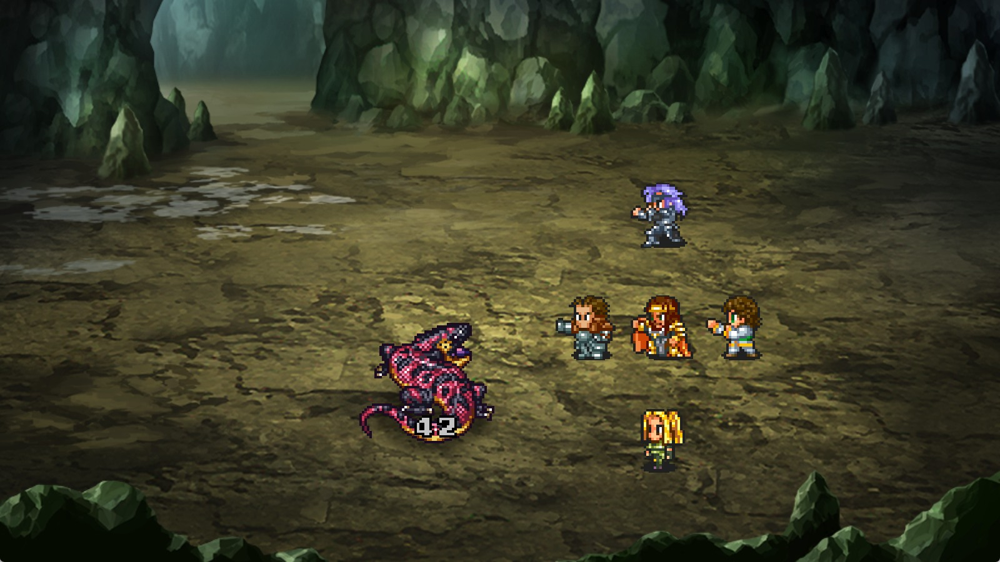 ダメージ数字もスーパーファミコン版のドット文字</td>
</tr>
<tr>
<td>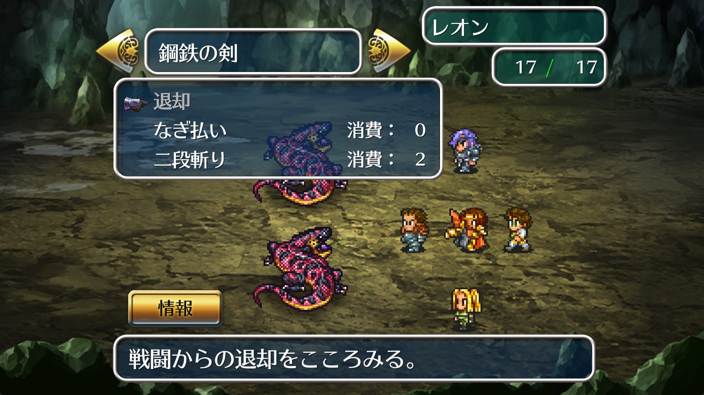 戦闘のコマンド入力中、L でカーソルの行に「退却」</td>
<td>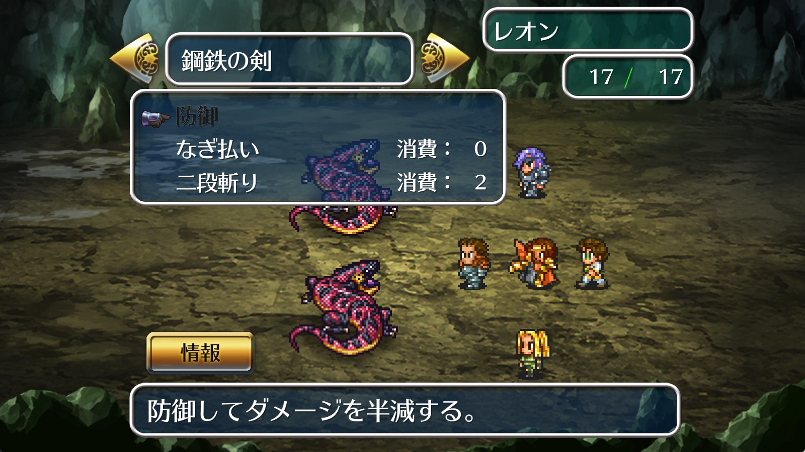 R で「防御」(スーパーファミコン版の操作)</td>
</tr>
<tr>
<td>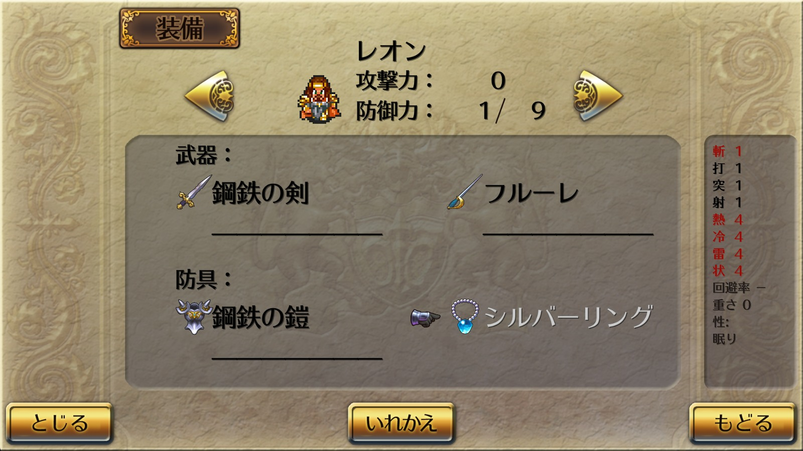 防具・盾の 8 種の防御力・特性・耐性・重さを画面右に</td>
<td>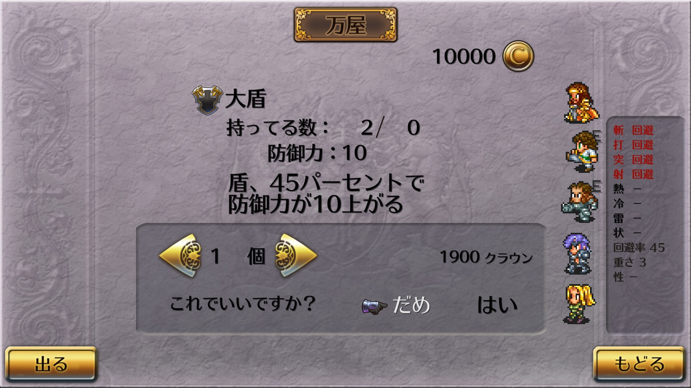 店で、その品物をすでに装備している仲間の絵に E</td>
</tr>
<tr>
<td>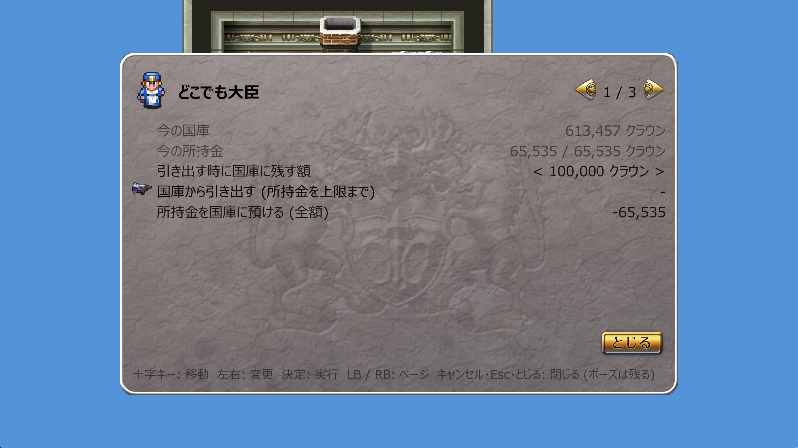 どこでも大臣 (フィールドで LB)。国庫から引き出す・預ける</td>
<td>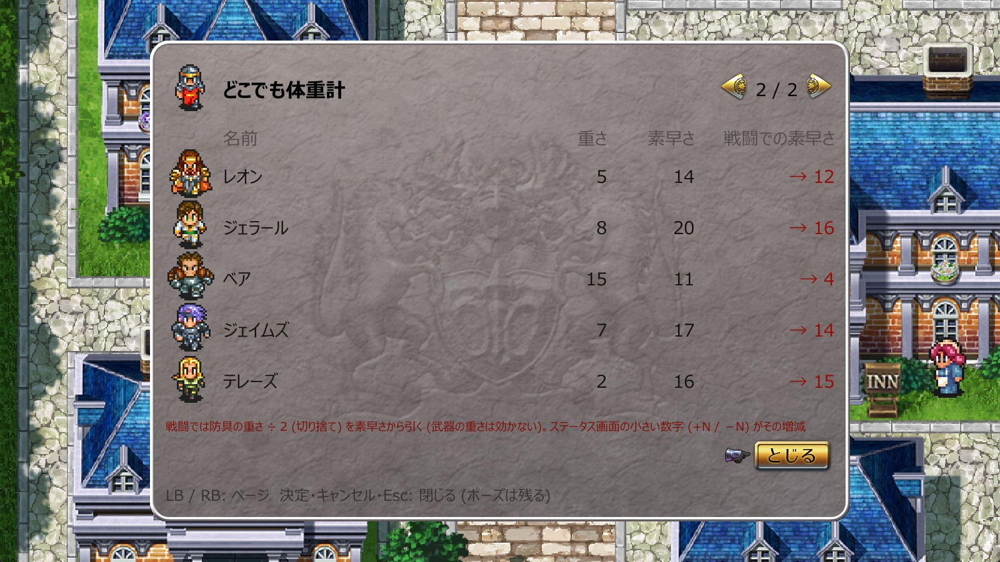 2 ページ目「どこでも体重計」。防具の重さと戦闘での素早さ</td>
</tr>
<tr>
<td>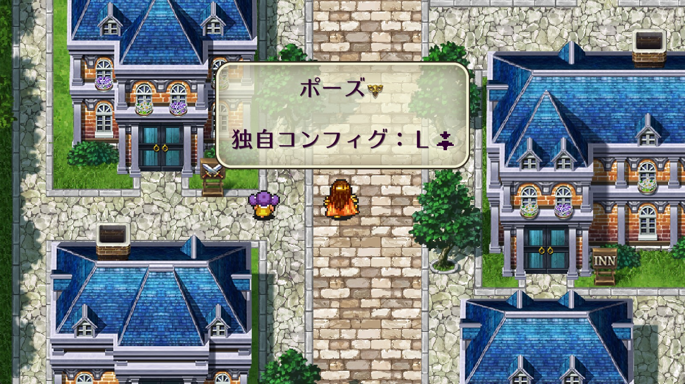 ポーズ (Start) の窓に MOD 設定画面を開くボタンの案内。他のボタンでは解除されない</td>
<td>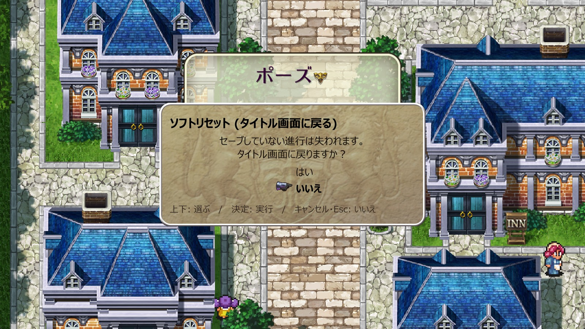 ソフトリセット (タイトルへ) の確認。敵に当たっても大丈夫</td>
</tr>
</table>

## 現在の機能

ボタン名・キー名は**既定の割り当て**で書いています (パッドはボタン割り当て、キーボードはキー割り当てで変えられます)。
キーボードのキーはパッドのボタンと同じ「機能」(決定・キャンセル・L / R など) に変換されるので、
下でパッドのボタンで書いてある操作は、同じ機能のキーでもそのまま効きます。

### ゲームパッドの入力

- **十字キーの斜め入力でキャラが止まる**問題を直す。
- **Bluetooth の Xbox コントローラー**で起きる 3 つの問題を直す: 十字キーを押したままなのに入力が途切れて止まる、A ボタンがたまに反応しない、ボタンを離したのに押したままと誤認されて次の押下が消える。
  - XInput 対応パッドの接続中は、十字キー・スティック・ボタンを Windows の XInput から読みます (Windows 専用)。
- **斜め入力の扱い**: 今の方向を維持し、同じ斜めを押し続けたら新しく足した方向へ転換。壁に当たったらもう片方へ曲がる (壁ずり)。
- **先行入力**: マス移動中に押した方向を、次にゲームが方向を読む瞬間まで覚えておく。押す直前の方向に親指が戻っただけでは取り消さない。
- **ボタン割り当て**: A / B / X / Y / LB / RB / Start / Select / LT / RT / L3 / R3 の 12 個に機能を置ける (決定 / キャンセル+ダッシュ / キャンセルのみ / ダッシュ・とじる / 情報・切替 / メニュー / マップ移動・情報・切替 / ポーズ / L / R / MOD 設定画面 / 倍速 ON/OFF / ソフトリセット / ゲームを終了 / 国庫から引き出す / どこでも大臣 / なし)。
- **既定はスーパーファミコン版の配置** (ボタンの物理位置で対応): A (下) = キャンセルのみ、B (右) = 決定、X (左) = ダッシュ、Y (上) = マップ移動。
  - キャンセルとダッシュを別のボタンに分けられます。本体と同じ A = 決定 / B = キャンセル+ダッシュ に戻すなら、設定画面で A を `OK`、B を `Cancel` にします。
  - 本体が使っていない LT / RT / L3 / R3 にも置けます。既定は LT = ソフトリセット、RT = 倍速 ON/OFF、L3 = MOD 設定画面、R3 = ゲームを終了。
- **スーパーファミコン版の「マップ移動」ボタン** (既定 Y): 建物の中なら外へ出る、町の外ならワールドマップ (行き先選択) を開く、ワールドマップの地域画面では大陸の一覧へ戻る。ダンジョンでは何もしない。
  - 本体の X と同じ信号なので、メニュー・戦闘では「情報・切替」(並べ替え、情報 など) として働きます。
- **ダッシュ** (既定 X): フィールドではダッシュだけ (メニューは開かない)。メニュー・戦闘では本体の Y と同じ「とじる」。

### キーボードの入力

- **キー割り当て**: 機能ごとに 1 つのキー (決定だけ 2 つ) を置ける。本体にはキーを変える画面がありません。
  - 既定は WASD 系 PC ゲームの共通配置: Space と Enter = 決定、左 Shift = キャンセル+ダッシュ、Esc = キャンセルのみ、M = マップ移動、Tab = メニュー、P = ポーズ、Q / E = L / R (前 / 次のページ)、F = 倍速 ON/OFF、T = どこでも大臣、F9 = ソフトリセット、F10 = ゲームを終了。
  - 方向の W A S D と矢印キー、F1 (MOD 設定画面)、F11 (本体の画面切替) は固定です。
  - 設定画面の「キー割り当て」ページで、左右で候補を送るか、決定してから押したキーで決めます (Esc は取り込みの中止に使うので、左右で送って付けます)。
- **Esc の扱い**: Esc をどれかの機能に付けている間 (既定はキャンセルのみ) は、本体の「ゲームを終了しますか？」は Esc では開きません。終了は F10、設定画面「その他」の項目、割り当てたボタンから。Esc をどの機能からも外せば本体どおり終了ダイアログになります。
- **F1 で MOD 設定画面**: ゲーム中のどの場面でも (フィールド・メニュー・戦闘・会話中・タイトル) 開けます。パッドの割り当てから「MOD 設定画面」を外してしまった時の非常口も兼ねます。

### スマホ移植の名残の修正

- **戦闘後の結果表示** (経験値 / HP / 技能 / アイテム / 見切り) が、ボタンを押したままだと読めずに流れる → 新たに押した時だけ送る。
- **会話ウィンドウと選択肢**が、決定を押したままだと流れて誤決定する → 新たに押した時だけ送る。十字キー (キーボードは方向キー) でも会話を送れる。 十字キーで会話を終えた直後に、同じ押しっぱなしで「触れると話しかけてくる人」の会話が即座にまた始まらないようにする (十字キーを一度離すまで)。
- **会話の文字送りの速さ**を 本体のまま / x2 / x3 / 即時 から選べる (既定は本体のまま)。本体のまま以外は、倍速の ON/OFF や倍率に関わらず実時間で同じ速さになる。
- **ぶつかるだけで話せる NPC と決定で話す NPC が混在**して面倒 → NPC に方向を押し当て続けると (既定 約 0.27 秒) 決定なしで話しかける。決定で話すのも今までどおり。
- **ポーズ (Start / P) が他のボタンでも解除される** → ポーズのボタンを押し直すか、キャンセル (パッド A、キーボード 左 Shift / Esc) を押した時だけ解除。無音だったポーズの開始に決定音、解除にカーソル音。
- **ポーズの窓の 3 行目に MOD 設定画面の開き方**を出す (例「独自コンフィグ：Ｌ[スティックの絵]」。「ポーズ」は 1 行目になる)。ボタン割り当てに合わせて変わり、パッドに割り当てが無ければ F1 と出ます。
- **起動時のプロローグのスクロールが Start でしか飛ばせない** → パッドは A / B / X / Y のどれでも、キーボードは決定・キャンセル・マップ移動のキー (既定 Space / Enter / 左 Shift / Esc / M) でも飛ばせる。会社ロゴも同じ。
- **戦闘の画面左右の矢印ボタン** (タッチ用) に Steam 版が付けた「L」「R」の文字を外し、元の矢印だけの絵にする。
- **タッチ用のボタンの絵がパッドで遊んでいても出続ける** (フィールドのダッシュ / メニュー / ワールド / 停止、メニュー画面下の とじる / もどる / 決定、戦闘の矢印 / 情報 / もどる、ワールドマップの ぜんたい / ちいき / とじる) → 設定 `[Window] HideTouchButtons` (既定 Off) で全部消せる。絵を消すだけなので、マウスで元の場所を押せば今までどおり効く。
- **防具の「防御力」が斬の値 1 つだけ**で、他の 7 種 (打・突・射・熱・冷・雷・状) や防御特性・状態異常耐性・重さが分からない → 持ち物・装備・店・預かり所で、カーソルが乗っている防具・盾の全部を画面右の小窓に出す (特性のある種類は赤字、盾は回避できる攻撃と回避率)。店は買う / 売る品物の一覧でもカーソルの品物を出す。
- **店で買う時に、その品物を誰がすでに装備しているか分からない** (パーティ全体の「装備数」しか出ない) → 買う / 売る品物の一覧と確認画面で、カーソルが乗っている品物を装備している仲間の絵の横に小さく E を出す。
  - E が付いた仲間は、戦闘でコマンドを決めた時と同じようにくるくる回って構えます (武器は攻撃の構え、防具や道具はコマンド窓が開いた時の構え)。E が誰にも付かなければ誰も回りません。
- **MOD の窓** (設定画面・どこでも大臣・ソフトリセットの確認・ゲームを終了のダイアログ) は、開く時に決定音、閉じる時にカーソル音で統一。

### スーパーファミコン版の操作

- **戦闘のコマンド入力中、L で「退却」、R で「防御」** (パッド LB / RB、キーボード Q / E) がカーソルの行に出る。もう一度押すか、十字キーを押すか、コマンドを決めると元に戻る。
  - 本体の「L / R でページ送り、L+R 同時押しで防御・退却のページへ」は戦闘では無くなります (十字キーの左右でのページ送りはそのまま)。
- **ダメージ数字をスーパーファミコン版のドット文字**で出す (スマホ版の大きくなめらかな数字の代わりに、ゲーム内に残っている元の数字を使う。既定 ON)。
- **ダメージ数字の跳ねの速さと、消えるまでの長さ**を別々に調整できる (本体の跳ねはスーパーファミコン版の 4 倍速。既定は跳ね 2 倍速、消えるまでの長さは本体どおり)。倍速中も見た目の速さを等倍と同じに保つ (既定 ON)。
- **ダメージ数字の縦位置**をモンスター / 味方で別々に調整できる (リマスター版はモンスターの足元より上に出るので、既定で足元に合わせてある)。
- **戦闘のモンスターと味方キャラの絵の大きさ**を % で変えられる。リマスター版は画面が縦 240 ドットなので、縦 224 ドットのスーパーファミコン版より 7 % 小さく見える。既定はどちらも 107 % (スーパーファミコン版と同じ見かけ。足元の位置は変わらない)。
- **技・攻撃アニメの速さ**を倍速に関係なく固定できる (等倍の本体を 100% として 25〜400%。既定は倍速に従う)。「コマンド入力や行動の間は x4 で飛ばし、技アニメだけ 1.5 倍」のような使い方ができる。
- **メニューで選んでいる文字の点滅** (戦闘のコマンド窓・フィールドのメニュー・店・会話の選択肢など) を、倍速中も等倍の速さに保つ (既定 ON)。
- **ワールドマップ (大陸の一覧・地域の地名一覧) のカーソルを自由に動かせる** (十字キー・スティック・キーボードの方向キー。本体はアイコンからアイコンへ瞬間移動)。場所の上に乗せた時だけ名前が出て決定で選べ、何も乗っていなければ決定は効かない。
  - 速さは設定画面「移動」で調整 (倍速中も同じ速さ)。該当する行には本体のカーソルの羽の絵が付きます。マウスのクリックはそのまま使えます。60fps 表示中はカーソルの動きも 60fps に補間します。
- **ワールドマップをキャンセルで閉じて町へ戻れる** (パッド A、キーボード Esc / 左 Shift)。本体は「とじる」(ダッシュ / とじる の機能、画面のボタン) でしか戻れず、キャンセルは何もしない。地域画面から大陸一覧へ戻るのは本体どおり マップ移動 (パッド Y、キーボード M)。
- **ワールドマップを開く / 閉じる時の巻物の動きと暗転**を、倍速中も等倍と同じ速さに保つ (本体は x2 だと巻物が 2 倍の速さで回り、閉じる動きが暗転に隠れていた。既定 ON)。

### 追加機能

- **MOD 設定画面**: ゲーム内で設定を変更・保存。見た目はゲーム本体のメニューの部品 (羊皮紙の背景・枠・手のカーソル・矢印・ボタン) を起動中のゲームから読んで使う。開き方・操作は下の「MOD 設定画面」を参照。
  - パッド: フィールドでポーズ中に L3 (左スティック押し込み)、タイトル画面の NEW GAME / CONTINUE でも同じボタン。ページ送りは LB / RB。
  - キーボード: F1 (どの場面でも)。ページ送りは Q / E。
- **倍速** (x1〜x4): 切り替えはパッド RT (ZR)、キーボード F、または設定画面。等倍に戻した直後は右上に x1 を 2 秒表示。
  - **押している間だけ倍速** (`[Speed] TriggerHold`、既定 OFF): ON にすると、パッドの倍速ボタンは押している間だけ効き、離すと押す前の状態に戻ります。LT / RT に割り当てていれば**引いた深さで倍率が変わります** (既定: 浅く引いて 10 % で x2、深く引いて 75 % で x4 の 2 段。x3 の段は既定では使わず、% を入れれば 3 段になります。戻す時は各段の % から 5 % 下回るまで保つので、トリガーの震えで行き来しません)。深さとゆとりの % は設定画面「ゲーム速度」で 1 % 刻みに変えられ、同じページにトリガーの今の引き量 (LT / RT の %) が出るので、離しているのに 0 にならない個体 (遊び) はそれを見て x2 の % を上に置けます。キーボードの F と設定画面の ON/OFF は切り替え式のままです。
  - 設定で「戦闘が終わったら等倍に戻す」「戦闘中は必ず x1.25〜x4 (0.25 刻み。または等倍)」「コマンド選択中だけ別の速さ (選択は x4 で飛ばし、行動は x1.5 など)」にもできます。
  - メニュー・店・預かり所などを開いている間は既定で等倍 (閉じると元の速さに戻る。設定で変更可)。フィールドは整数倍のみ (端数の倍率は歩きがガクつくため)。
- **音量** (全体 / BGM / 効果音)。本体には音量設定が無く起動時から最大音量で鳴るため、全体の既定は 30%。
- **画面モード** (ウィンドウ / ボーダーレス (枠なしでモニター全体) / フルスクリーン)。本体は F11 の排他フルスクリーンのみ。
- **マウスカーソルの自動非表示** (マウスを触った時だけ出す)。
- **画面のボタンの丸文字を消す**: 「Ⓐけってい」「Ⓑもどる」「Ⓧ地域」などの丸文字を消して文字を中央に、ページ送りの矢印から L / R の文字を消す (ボタン割り当てを変えると丸文字が合わなくなり、キーボードでは意味が無いため。ボタンはマウスで押せるので残す。文字の大きさは本体のまま)。ページ送りの矢印 (メニューの HP / LP の切替など) は `[Display] ArrowButtonScalePercent` で小さくできる (スーパーファミコン版には無い絵なので差し替え元は無い)。
- **画面の同期** (垂直同期 / VRR / 変更しない)。本体は 30fps のフレーム間隔が 26〜40ms と暴れて、フィールドのスクロールがガタつく・裂けて見えることがある → 垂直同期 (60Hz / 120Hz なら画面更新の 2 回 / 4 回に 1 フレームで完全に 30fps 固定) と正確な 33.3ms 刻みのフレームリミッタで揃える。G-Sync / FreeSync のモニターなら VRR を選ぶ。
- **60fps 表示**: ゲームの進行速度は本体どおり 30 コマ/秒のまま、画面だけ 60fps にする。フィールドのスクロール、キャラ (自分・仲間・NPC)、建物などの動きを 1 コマの中間位置で補間。戦闘の味方キャラの移動とダメージ数字の跳ね、敵シンボルに接触した時の拡大も補間。モンスターや技のエフェクト、メニューは 30 コマのまま。
- **ソフトリセット (タイトル画面に戻る)**: パッド LT、キーボード F9、または設定画面「その他」の項目 → 確認ダイアログで上下で「はい」を選んで決定。**ゲーム中ならどこからでも**戻れる: フィールド・ポーズ中・メニュー・店・ワールドマップ・会話中・イベント中・戦闘 (演出中・結果表示中も)・CONTINUE のセーブ選択画面。
  - 本体は メニュー → 設定 → タイトルへ の 3 階層で、戦闘中やイベント中は戻れません。
  - フィールドで動ける時はダイアログ中に自動でポーズし、キャンセルすれば解除。それ以外の場面ではダイアログの間もゲームは止まりません (本体の Esc ダイアログと同じ)。
- **ゲームを終了 (Steam に戻る)**: パッド R3、キーボード F10、または設定画面「その他」の項目 → 本体が Esc で出す「ゲームを終了しますか？」のダイアログ。本体はキーボードの Esc かウィンドウの × でしか終了できない。
- **敵が強くなる速さの調整と一時停止**: ロマサガ2 の敵は戦闘回数で強くなる。% で変えられ (50 % なら本体の 2 倍の戦闘回数をかけて強くなる。敵の系統ごとに違う強くなる目安も全部同じ割合で伸び縮みする)、既定は本体どおり。「敵の成長を一時停止する」もある。
  - たまに乱数で強い敵が混ざる本体の挙動はそのまま。読み替えるのは敵決めだけで、新しく仲間になる人の初期 HP・アバロンの発展・ゲーム内の戦闘回数の表示は本体どおり。
  - 設定画面の「敵の成長」ページに今の戦闘回数と出る敵レベルの範囲、本体換算の戦闘回数、今の % で敵レベル 2〜11 と上限が何戦目になるかを表示。
- **味方の成長の速さの調整**: HP・技レベル (武器)・術レベル・全体レベル (新しく加入する仲間の初期レベル) をそれぞれ % で変えられ、既定は本体どおり。
  - ロマサガ2 の味方は 1 戦で倒した敵の技術点で育つので、その技術点を項目ごとに別の倍率で読み替える。1 回に上がる量と上限 (HP 999 / レベル 50 / 全体 40) は本体のまま。
  - 技術点は敵の強さで決まるので、「敵が強くなる速さ」を下げると味方の成長も遅くなる。それを補うための項目。設定画面の「味方の成長」ページに直前の戦闘の技術点と換算値を表示。
- **税収の倍率**: ロマサガ2 では戦闘でお金は手に入らず、税収が戦闘のたびに自動で国庫に入る (玉座に戻る必要はない)。その額を % で変えられ、既定は本体どおり。
  - 敵の強さ・味方の成長・宝箱の N 万クラウン・施設の費用は変わらないので、「敵は遅く、お金は普通に」「敵は普通、お金は多め」のどちらも組める。設定画面の「国庫」ページに今の国庫と 1 戦ごとに入る税収を表示。
- **所持金 (財布) の上限引き上げ**: ロマサガ2 の所持金は 1 万クラウンが上限で、補充はアバロンの玉座の間の大臣に会うしかない。上限を 65,535 まで上げられ (既定 65,535。セーブの形式上これが最大)、宝箱や店の売却で入る金もそこまで持てる。城の大臣は本体どおり 1 万まで。
- **どこでも大臣**: フィールドで歩ける時とポーズ中に、国庫から所持金を上限まで引き出せる窓 (詳しくは下の「MOD の窓」)。
  - パッド: LB で窓が開き、RB は窓を開かずに即引き出す (フィールドでは本体が LB / RB を使わないので、歩ける時とポーズ中だけ別の役目にしてある。設定で変えられる)。窓のページ送りも LB / RB。
  - キーボード: T で窓が開く。即引き出すキーは既定では無し (キー割り当てで付けられる)。窓のページ送りは Q / E。
  - 引き出す時に国庫に残す額 (既定 100,000。施設の費用を取り崩さないため) を決められ、所持金を全額国庫に預けることもできる。歩ける時は自動でポーズしてから開き、閉じてもポーズは残る。
  - 2 ページ目は「どこでも体重計」= 仲間ごとに歩きの絵・名前・防具の重さ・素早さ・戦闘での素早さ (重さで下がる人は赤) を並べる (本体は倉庫の体重計に乗ると重さは分かるが、内訳までは分からない)。
- **ステータス画面の素早さの小さい数字**を、防具の上昇から重さ ÷ 2 を引いた「戦闘での増減」(+N / －N) にする。本体は上昇だけを出して重さを引かないので、重い防具で素早さが下がっていることが画面で分からない。大きい数字 + 小さい数字 = 戦闘で使われる素早さ (既定 ON)。

機能はすべて設定ファイルか MOD 設定画面で個別に ON/OFF・調整できます。

## 動作環境

- Windows 10 / 11 の Steam 版ロマンシング サガ2 (`rs2.exe`、Unity 5.6)
- BepInEx 5.4.x (win_x64)
- ゲームパッドは **Xbox ワイヤレス コントローラー (Bluetooth / Xbox ワイヤレス アダプター)** で動作確認済み。有線 (USB) 接続は未確認です。
  ゲーム本体が Xbox 配列のボタン・軸番号を決め打ちしているため、DualSense / Switch Pro などの Xbox 以外のパッドは
  **Steam の設定でそのゲームの「Steam Input」を有効にし、Xbox コントローラーとして見せる**必要があります
  (Steam Input を無効にしたままだと、本 MOD の有無にかかわらず正しく動きません)
- Windows で動作確認済み。Linux (Proton) は未検証です (入力の併読に Windows の XInput を使います)

## 導入手順

1. [BepInEx 5.4.x (win_x64)](https://github.com/BepInEx/BepInEx/releases) をダウンロードし、中身をゲームフォルダ
   (`...\steamapps\common\RomancingSaGa2\`、`rs2.exe` がある場所) に展開する。
2. ゲームを 1 回起動して終了する (`BepInEx\config` などが作られる)。
3. [Releases](https://github.com/Yukemurigarage/RS2QoL/releases/latest) から zip をダウンロードし、
   `RS2QoL.dll` を `BepInEx\plugins\RS2QoL\` に置く。
4. ゲームを起動する。`BepInEx\LogOutput.log` に `Loading [RS2QoL x.y.z]` と出ていれば読み込まれています。

外すときは `BepInEx\plugins\RS2QoL\` を削除するだけです。BepInEx ごと外すならゲームフォルダの
`BepInEx\`、`winhttp.dll`、`doorstop_config.ini` を削除します。

## MOD 設定画面

ゲーム内で MOD の設定を変えて保存する画面です。見た目はゲーム本体のメニューの部品 (羊皮紙の背景と枠、手のカーソル、L / R の矢印、とじる ボタン) を起動中のゲームから読んで使っています。MOD に画像は入っていません。効果音も本体のメニューと同じです。

### 開き方

| 装置 | 開けるボタン | 開ける場面 |
|---|---|---|
| ゲームパッド | **L3 (左スティック押し込み)** (ボタン割り当てで変えられます) | フィールドで **Start を押してポーズしている間**、タイトル画面の NEW GAME / CONTINUE の選択中 |
| キーボード | **F1** (固定) | ゲーム中の**どの場面でも** (フィールド・メニュー・戦闘・会話中・タイトル)。本体の「ゲームを終了しますか？」が出ている間だけ開きません |

- パッドでは、ポーズが無い場面 (戦闘・メニュー・会話中) では開けません。先に Start でポーズしてください。タイトル画面で開けるのは、ゲームを始める前に倍速やボタン割り当てを決められるようにするためです。
- キーボードの F1 は非常口も兼ねています (パッドの割り当てから「MOD 設定画面」を外してしまっても F1 で開けます)。フィールドで歩ける時に F1 を押すと、裏でゲームが進まないように先にポーズをかけてから開きます。閉じてもポーズは残るので、Start かキャンセルで解除してください。
- F1 で戦闘中などポーズの無い場面で開いた時は、開いている間もゲームは止まりません (この画面が入力を受け取るのでゲームには渡りませんが、技の演出などは流れます)。

### 操作

| 操作 | ゲームパッド | キーボード (既定の割り当て) | マウス |
|---|---|---|---|
| ページを切り替える | **LB / RB** (割り当てを変えていても効きます) | **Q / E** (前 / 次のページのキー) | 画面上の L / R の矢印をクリック |
| カーソルを動かす | 十字キー (長押しで連続) | W A S D か矢印キー | — |
| 値を変える | 十字キーの左右 | A / D か ← → | — |
| 実行する (とじる、ボタン割り当てへ、ソフトリセット など) | 決定 (既定 B) | Space か Enter | ボタンをクリック |
| 選んでいる行を既定に戻す | キャンセル (既定 A) | 左 Shift (キャンセル+ダッシュのキー) | — |
| 閉じる | 開いたボタン (既定 L3)、または とじる | F1、Esc、または とじる | とじる をクリック |

- **キャンセルでは閉じません** (選んでいる行の値を既定に戻すだけ。ボタン割り当て・キー割り当ての行も 1 つずつ戻せます)。閉じるのは「とじる」(最下行の次にカーソルが乗る右下のボタン) か、開いたボタン・F1・Esc です。
- 変更はその場で設定ファイルへ保存されます。次に開いた時は前回のページから始まります。

### ページ

項目は 13 ページに分かれています (ボタン割り当て / キー割り当て / 音量 / 画面 / ゲーム速度 / 移動 / 会話 / 戦闘 / 戦闘の見た目 / 敵の成長 / 味方の成長 / 国庫 / その他。ゲームの外側の設定から順に、後ろほど細かい調整)。

- **ボタン割り当て** (1 ページ目、ゲームパッド用): 他のページからも右下 (とじる の左) の「ボタン割り当て」ボタンで直接移れます。右上に「押しているボタン」が出ます (割り当ての確認用)。割り当ては左右で変えます (決定では変わりません。ボタンを試しに押して値が動かないように)。右に送る順番は既定の割り当てを上から並べた順 (キャンセルのみ → キャンセル+ダッシュ → 決定 → ダッシュ → マップ移動 → 情報・切替 → L → R → ポーズ → メニュー → ソフトリセット → 倍速 ON/OFF → MOD 設定画面 → ゲームを終了 → 国庫から引き出す → 国庫の画面 → なし) です。既定と違う割り当ては赤い文字で出ます。
- **キー割り当て** (2 ページ目、キーボード用): 機能ごとに 1 つのキーで、左右で候補を送るか、決定すると「キーを押してください」になり次に押したキーが入ります (画面全体が暗くなって、その行と左下の案内だけ明るく残ります。Esc で中止)。同じキーが他の機能に付いていればそちらは「なし」になります。右上に「押しているキー」が出ます。既定は WASD 系の PC ゲームの共通配置 (Space と Enter = 決定、左 Shift = キャンセル+ダッシュ、Esc = キャンセルのみ、Tab = メニュー、M = マップ移動、P = ポーズ、Q / E = 前 / 次のページ、F = 倍速、T = どこでも大臣、F9 = ソフトリセット、F10 = ゲームを終了) で、方向の W A S D と矢印キー、F1、F11 は固定です。Esc をどれかの機能に付けている間は、本体の「ゲームを終了しますか？」は Esc では開きません (F10、「その他」の「ゲームを終了」、割り当てたボタンから)。
- **移動**: 先行入力 (マス移動中に押した方向を覚えておく長さ。`[Input] InputBufferFrames`) と、先行入力として採用するのに必要な押し続けフレーム数 (`[Input] BufferTapMinFrames`。既定 1 で、1 フレームしか読めない短い入力も拾う。親指のブレで一瞬混ざった方向まで拾ってしまうなら 2 にする) を変えられます。どちらもその場で効きます。
- **その他**: ソフトリセット (タイトル画面に戻る) と ゲームを終了 (Steam に戻る) の項目があります (下の「MOD の窓」を参照)。

## MOD の窓 (どこでも大臣 / ソフトリセット / ゲームを終了)

設定画面と同じ部品で描く、設定画面とは別の窓です。どれも開く時に決定音、閉じる時にカーソル音が鳴ります。

- **どこでも大臣**: パッドはフィールドで **LB** を押すと「どこでも大臣」の窓が開きます (キーボードは **T**。パッドの **RB** は窓を開かずに国庫から上限まで引き出し、結果を画面上部の小窓 (同じ灰色の紙に大臣の絵と「どこでも大臣」の見出し付き) に数秒出します)。フィールドでは本体が LB / RB を使わないので、歩ける時とポーズ中だけこの役目になります (メニュー・戦闘・会話中は本体どおりページ送り / 退却・防御 / 会話送り)。役目は「国庫」ページの「フィールドでの LB / RB」(なし / どこでも大臣の画面 / 国庫から引き出す) で入れ替えられ、ボタン割り当ての `Treasury` / `Withdraw` で他のボタンにも置けます。窓は設定画面とは別で、本体の倉庫画面と同じ灰色の紙の上に、歩く大臣の絵 (アバロン城の玉座の間の大臣と同じ、本体のフィールドの NPC の絵) と、今の国庫・所持金、引き出す時に国庫に残す額 (左右で変更)、国庫から引き出す、所持金を国庫に預ける、とじる が並びます。歩ける時は自動でポーズしてから開き、閉じてもポーズは残ります (Start で解除)。窓は 2 ページで、開いている間の LB / RB (キーボードは前 / 次のページのキー、既定 Q / E) でページを送ります (2 ページ目は「どこでも体重計」)。閉じるのは とじる・キャンセル・Esc。大臣はいつの時代も有能じゃないと…。
- **ソフトリセット (タイトル画面に戻る)**: 設定画面の「その他」の項目か、割り当てたボタン (パッドは既定 **LT**、キーボードは既定 **F9**) で確認ダイアログが開き (上下で はい / いいえ、決定で実行。初期カーソルは いいえ)、タイトルへ戻れます。ゲーム中ならどこからでも戻れます (タイトル画面の NEW GAME / CONTINUE 選択中と、本体の終了ダイアログ中を除く)。フィールドで動ける時は確認の間だけ自動でポーズし、それ以外の場面では確認の間もゲームは止まりません (本体の Esc ダイアログと同じ)。予約されていたオートセーブ (戦闘直後など) は行われません。
- **ゲームを終了 (Steam に戻る)**: 設定画面の「その他」の項目か、割り当てたボタン (パッドは既定 **R3**、キーボードは既定 **F10**) で、本体がキーボードの Esc で出す「ゲームを終了しますか？」のダイアログを開きます (上下で はい / いいえ、決定で実行。初期カーソルは いいえ)。ゲーム中どこでもボタン 1 つで出せます。フィールドで動ける状態なら先に本体のポーズ (Start) をかけてからダイアログを出し、いいえ で戻るときに解除します (自分でポーズしてから押した場合は解除しません)。ポーズがかけられない場面 (戦闘・メニュー・会話中など) でも、ダイアログが開いている間は下のゲームにパッドの入力を渡しません (本体は Esc で開いても主人公が歩き、ワールドマップではカーソルが動いてしまう。MOD の自由カーソルも止めます)。

## おすすめの設定 (作者が遊んでいる値)

既定値は「入れただけでは本体の感じを変えない」側に寄せてあります。作者は次の値で遊んでいます。どれも MOD 設定画面で変えられます (戦闘の速さの 4 つは「戦闘」のページ、倍速の表示は「ゲーム速度」、数字の大きさは「戦闘の見た目」)。

| 設定 | 既定 | 作者 | ねらい |
|---|---|---|---|
| `[Speed] BattleSpeed` | 0 | 200 | 戦闘が始まったら自動で x2。フィールドは等倍のまま |
| `[Speed] CommandSpeed` | 0 | 275 | コマンド選択中はさらに速く (x2.75) 送る |
| `[Battle] AttackAnimSpeed` | 0 | 175 | 技・攻撃の動きだけは倍速に引きずられず、等倍の 1.75 倍の一定の速さに |
| `[Speed] ResetAfterBattle` | false | true | 戦闘が終わったら等倍に戻す。上の 3 つと組で「フィールドは等倍、戦闘だけ速い」になる |
| `[Speed] Indicator` | Always | OnToggle | 右上の x2 表示は切り替えた直後の 2 秒だけ |
| `[Battle] DamageHoldStep` | 4 | 3 | ダメージ数字を本体より少し長く残す |
| `[Battle] DamageDigitsScalePercent` | 100 | 107 | ドット文字のダメージ数字をスーパーファミコン版と同じ見かけの大きさに |
| `[Field] TalkOnBumpFrames` | 8 | 2 | NPC に当たったらほぼ即座 (0.07 秒) に話しかける。既定の 8 は 0.27 秒押し当ててから |
| `[WorldMap] CursorSpeed` | 4 | 3 | ワールドマップの自由カーソルを少しゆっくりに |

戦闘の速さの 4 つは組で使うものです。BattleSpeed を 125 以上にすると、倍速 OFF のままでも戦闘が始まった瞬間に倍速 ON になり、ResetAfterBattle でフィールドに戻る時に OFF に戻ります。

## 設定 (`BepInEx\config\net.my-p.rs2qol.cfg`)

初回起動時に自動生成されます。MOD 設定画面から変えられる項目はそちらで変えるのが簡単です。
フレーム数の項目は 1 フレーム ≒ 33ms (歩き 1 マス = 8 フレーム) です。

### 入力 `[Input]`

| 設定 | 既定 | 内容 |
|---|---|---|
| `DiagonalPolicy` | Keep | 斜め入力の扱い。Keep=今の方向を維持 / Newest=新しく押した方向へ即転換 (親指のブレに弱い) |
| `DiagonalSwitchFrames` | 3 | Keep で同じ斜めがこのフレーム数より続いたら新しく足した方向へ転換 (0 で転換しない) |
| `DiagonalGraceFrames` | 4 | ニュートラルから斜めに入った時に単独方向になるのを待つフレーム数 (0 で待たない) |
| `WallTurnFrames` | 3 | 斜めを押していて進めない時にもう片方へ曲がるまでのフレーム数 (0 で無効) |
| `InputBufferFrames` | 10 | 先行入力: マス移動中に押した方向を離した後も覚えておくフレーム数 (0 で無効)。押したままなら忘れない |
| `BufferTapMinFrames` | 1 | 先行入力として採用するのに必要な押し続けフレーム数 (2 にすると 1 フレームのブレを除外する代わりに短い入力が落ちる) |
| `XInputDpad` | true | XInput でも十字キーと左右スティックを読んで合成する (Windows 専用) |
| `XInputDpadExclusive` | true | XInput のパッドが接続中は方向を XInput だけから読む (Unity 側の読みが斜めや無入力のまま固まる対策)。キーボードの方向キーは残る。XInput 対応パッドと非対応パッドを同時に繋いで非対応の方を使う時だけ false |
| `XInputButtons` | true | XInput でもボタン (A/B/X/Y/LB/RB/Start/Select) を読んで合成する (Windows 専用) |
| `XInputButtonsExclusive` | true | XInput のパッドが接続中はボタンを XInput だけから読む (Unity 側の読み取りが、離したのに押したままになる対策)。キーボードは残る。`XInputDpadExclusive` と同じ考え方 |

### ボタン割り当て `[ButtonMap]`

| 設定 (物理ボタン) | 既定 |
|---|---|
| `Button0` (A) | CancelOnly (キャンセルのみ。SFC の B の位置) |
| `Button1` (B) | OK (決定。SFC の A の位置) |
| `Button2` (X) | Dash (ダッシュ / とじる。SFC の Y の位置。フィールドではダッシュ (メニューは開かない)、メニュー・戦闘では本体の Y と同じ「とじる」(メニュー) の働き) |
| `Button3` (Y) | MapMove (マップ移動 / 情報・切替。SFC の X の位置。フィールドでは建物の中なら外へ、町の外ならワールドマップへ、ワールドマップの地域画面では大陸の一覧へ戻る。メニュー・戦闘では本体の X と同じ 情報・切替 (並べ替え、情報 など)。信号は `Info` と同じ) |
| `LB` / `RB` | L / R (前ページ / 次ページ) |
| `Start` | Pause (ポーズ) |
| `Select` (View / Back) | Menu (メニュー) |
| `LT` (ZL) / `RT` (ZR) | SoftReset (ソフトリセット = タイトルに戻る) / SpeedToggle (倍速 ON/OFF)。ゲーム内では未使用。XInput でのみ読む (Windows 専用)。引き量 1/4 以上で押下扱い |
| `L3` / `R3` (スティック押し込み) | ConfigMenu / Quit (L3 = MOD 設定画面、R3 = ゲームを終了)。ゲーム内では未使用 |
| `LB+RB` (LB と RB の同時押し) | None (なし)。どこでも大臣は既定ではフィールドの LB 単独 (`[Economy] FieldLB`)。同時押しに「どこでも大臣」(`Treasury`) を割り当てるなら `FieldLB` / `FieldRB` を `None` にする (同時押しは「両方が押されている間」で、LB / RB 単独のビットもそのままゲームに渡る) |
| `DefaultsVersion` | 3 | 既定の世代 (MOD が管理。手で変えない) |

値は `None` `OK` `Cancel` (キャンセル + ダッシュ) `CancelOnly` (キャンセルのみ) `Dash` (ダッシュ / とじる) `Info` (情報・切替。本体の X) `Menu` `MapMove` (マップ移動 / 情報・切替。`Info` と同じ信号) `Pause` `L` `R` `ConfigMenu` `SpeedToggle` `SoftReset` (ソフトリセット = タイトルに戻る) `Quit` (ゲームを終了。本体の Esc と同じ終了ダイアログを開く) `Withdraw` (国庫から所持金へ引き出す。フィールドで歩ける時とポーズ中だけ。ゲームには渡らない) `Treasury` (どこでも大臣の窓を開く。フィールドで歩ける時とポーズ中だけ。歩ける時は自動でポーズしてから開き、閉じてもポーズは残る。ゲームには渡らない。既定では割り当てず、フィールドの LB (`[Economy] FieldLB`) で開く) のいずれか。
`Dash` はフィールドの操作 (`Core.move_human_sub_r`) の中ではダッシュ (メニューは開かない)、それ以外では本体の Y と同じ「とじる」(メニュー) として働きます。`MapMove` は本体の X とまったく同じ信号で、フィールドではマップ移動、ワールドマップでは地域画面から戻る、メニュー・戦闘では情報・切替になります。

### キー割り当て `[KeyMap]`

| 項目 | 既定 | 説明 |
|---|---|---|
| `[KeyMap] OK` ほか機能ごとに 1 項目 (`OK2` (2 つ目の決定) `Cancel` `CancelOnly` `Dash` `MapMove` `Menu` `Pause` `L` `R` `ConfigMenu` `SpeedToggle` `SoftReset` `Quit` `Withdraw` `Treasury`) | OK=Space, OK2=Return, Cancel=LeftShift, CancelOnly=Escape, MapMove=M, Menu=Tab, Pause=P, L=Q, R=E, SpeedToggle=F, SoftReset=F9, Quit=F10, Treasury=T、他は None | キーボードでその機能にするキー (Unity の KeyCode 名。None = なし)。1 機能 1 キーで、同じキーを 2 つの機能には付けられない。Escape をどれかに付けている間は本体の終了ダイアログを Esc で開かない。方向の W A S D と矢印キー、F1 (MOD 設定画面)、F11 (本体の画面切替) は固定。設定画面「キー割り当て」ページからも変えられる |

### その他

| 設定 | 既定 | 内容 |
|---|---|---|
| `[Field] DialogueWaitForPress` | true | 会話の送りと選択肢の決定を、ボタンを新たに押した時だけにする |
| `[Field] DialogueAdvanceByDpad` | true | 会話ウィンドウを十字キーでも送れるようにする |
| `[Field] MessageSpeed` | Default | 会話ウィンドウの文字送りの速さ。`Default` (本体のまま) / `x2` / `x3` / `Instant` (即時に全文)。Default 以外は倍速の ON/OFF や倍率に関わらず実時間で同じ速さ (▼ 待ち・ウェイト・スクロールの速さは本体のまま。戦闘中のメッセージは対象外) |
| `[Field] TalkOnBump` | true | NPC に十字キーを押し当て続けると決定を押さなくても話しかける (決定で話す人が対象。宝箱は開かない)。会話を閉じた時に押していた方向は、一度離すまで押し当てと数えない |
| `[Field] TalkOnBumpFrames` | 8 | 話しかけるまでに押し当て続けるフレーム数 (1〜30、1 フレーム ≒ 33ms。既定 8 ≒ 0.27 秒)。倍速中も実時間基準 |
| `[Field] TalkOnBumpCooldownFrames` | 10 | 会話・イベントが終わってから押し当てを数え始めるまでの待ちフレーム数 (0〜60。既定 10 ≒ 0.33 秒) |
| `[Field] PauseHint` | true | ポーズ (Start) の窓の 3 行目 (本体では空行) に、MOD 設定画面を開くボタン (例: 独自コンフィグ：Ｌ[スティックの絵]。スティック押し込み以外なら「独自コンフィグ：Ａ」のように) を本体の文字と同じ描き方で出す (「ポーズ」は 1 行目になる。Select / Start / X は半角で出す。窓の幅に入らなければ「独自設定：Select」のように縮める)。割り当てが無ければ Ｆ１ |
| `[Battle] ResultWaitForPress` | true | 戦闘後の結果表示を、決定・キャンセル・十字キーを新たに押した時だけ送る |
| `[Battle] SfcLR` | true | 戦闘のコマンド入力で L を押すとカーソルの行に「退却」、R を押すと「防御」を出す (スーパーファミコン版と同じ。もう一度押すと戻る)。false なら本体どおり L / R は前/次のページ (十字キー左右と同じ) |
| `[Battle] DamageAnimStep` | 2 | ダメージ数字の跳ねの速さ (1〜4)。小さいほど跳ねがゆっくりで桁が順に出る。4 が本体どおり、1 がいちばんゆっくり (スーパーファミコン版より遅い) |
| `[Battle] DamageHoldStep` | 4 | ダメージ数字が跳ね終わってから消えるまでの長さ (1〜4)。4 が本体どおり、小さいほど長く残る |
| `[Battle] DamageAnimRealTime` | true | 倍速中もダメージ数字の跳ねと消えるまでの見た目の速さを等倍の時と同じに保つ (上の 2 つの値を等倍の時の値として倍率で割って進める)。false なら倍速中は倍率分速くなる |
| `[Battle] AttackAnimSpeed` | 0 | 技・攻撃アニメの速さ。0=倍速に従う (本体どおり。倍速なら倍率分速くなる) / 25〜400=倍速に関係なく、等倍の本体を 100 とした % の実時間の速さに固定 (25 刻み。150 なら x2 でも x4 でも等倍の 1.5 倍)。コマンド入力や行動の間は倍速のまま |
| `[Battle] DamageDigitsSfc` | true | ダメージ数字をスーパーファミコン版のドット文字で出す。false ならスマホ版の大きい数字 (本体どおり) |
| `[Battle] DamageDigitsScalePercent` | 100 | ドット文字にしたダメージ数字の大きさ (%)。100 = 絵の 1 ドットが画面の 1 ドット (縁込みで幅 8・高さ 9 ドット)。107 = スーパーファミコン版と同じ見かけ (画面の縦が 240 ドット対 224 ドットのぶん)。112 = 本体の描き方と同じ大きさ (半ドットずれて 9/8 に伸びる)。数字の並びの中央・下端を基準に送りも一緒に伸び縮みする。MOD 設定画面の「戦闘」ページからも変えられる |
| `[Battle] PartyHpSfc` | true | 戦闘のコマンド入力中の味方の HP / LP を、スーパーファミコン版と同じ「現在値/最大値」の 2 行・同じ細いドット文字で出す (インペリアルクロスの中列中央など隣と重なる人は SFC 版と同じく 16 ドット上に出す)。false ならスマホ版の大きい数字で現在値だけ (本体どおり) |
| `[Battle] MonsterScalePercent` | 107 | 戦闘のモンスターの絵の大きさ (%)。100 = 本体どおり。既定 107 = スーパーファミコン版と同じ見かけの大きさ (リマスター版は画面が縦 240 ドットなので、縦 224 ドットのスーパーファミコン版より全体が 7 % 小さく見える。味方や背景はそのままなので、モンスターだけ相対的に大きくなる)。MOD 設定画面の「戦闘」ページからも変えられ、戦闘中でもすぐ反映される |
| `[Battle] PlayerScalePercent` | 107 | 戦闘の味方キャラの絵の大きさ (%)。100 = 本体どおり。既定 107 = スーパーファミコン版と同じ見かけの大きさ (理由は MonsterScalePercent と同じ)。足元の中央を基準に拡大するので足元の位置は変わらない。足元の影とダメージ数字の位置は本体のまま。MOD 設定画面の「戦闘の見た目」ページからも変えられ、戦闘中でもすぐ反映される |
| `[Battle] DamageYOffsetMonster` | 4 | モンスターに出るダメージ数字の縦位置の調整 (−32〜32 ドット、下が正。画面は 240 ドット角。0 = 本体どおり。既定 4 でドット文字の数字が足元に合う。v0.27.0 までの既定 3 は本体の 112 % に伸びた数字で合わせた値) |
| `[Battle] DamageYOffsetPlayer` | 0 | 味方に出るダメージ数字の縦位置の調整 (−32〜32 ドット、下が正。既定 0 = 本体どおり。v0.27.0 までの既定は -1) |
| `[WorldMap] FreeCursor` | true | ワールドマップのカーソルを十字キー・スティックで自由に動かす (スーファミ版の操作)。false なら本体どおりアイコンへ瞬間移動 |
| `[WorldMap] CursorSpeed` | 4 | 自由カーソルの速さ (1〜16。実時間 33ms あたりのドット数。マップは 240 ドット幅。倍速中も同じ速さ) |
| `[WorldMap] ScrollSpeedFixed` | true | ワールドマップを開く / 閉じる時の巻物の動きと暗転 (フェード) を、倍速中も等倍と同じ速さ (実時間で固定) にする。本体は x2 だと巻物が 2 倍の速さで回り、閉じる動きが暗転に隠れる |
| `[Title] AnyButtonSkip` | true | 起動時のプロローグのスクロールを Start だけでなく A/B/X/Y でも飛ばす |
| `[Menu] ArmorDetail` | true | 持ち物・装備・店・預かり所で、カーソルが乗っている防具・盾の 8 種の防御力 (斬・打・突・射・熱・冷・雷・状)、防御特性 (赤字)、状態異常耐性、重さ (盾は回避できる攻撃と回避率) を画面右の小窓に出す。本体は「斬」の値だけを防御力として表示している |
| `[Speed] Multiplier` | 2 | 倍速 ON 時の倍率 (1〜4) |
| `[Speed] StartEnabled` | false | 起動時から倍速 ON |
| `[Speed] TriggerHold` | false | 倍速ボタン (`[ButtonMap]` の SpeedToggle) を押している間だけ倍速にする。LT / RT なら引いた深さで x2 / x3 / x4 (下の 4 つ)、他のボタンなら押している間 Multiplier。離すと押す前の状態 (OFF、または戦闘の自動倍速) に戻る。キーボードの倍速キーと設定画面は切り替え式のまま |
| `[Speed] HoldX2Percent` / `HoldX3Percent` / `HoldX4Percent` | 10 / 0 / 75 | TriggerHold でトリガーの深さ (%) がこの値以上なら x2 / x3 / x4 (x3・x4 は 0 でその段を使わない。既定は x2 と x4 の 2 段。上の段ほど大きい値にする) |
| `[Speed] HoldReleasePercent` | 5 | TriggerHold で段を下げる時のゆとり (%)。各段は「その段の % − この値」を下回るまで保つ (既定なら x2 は 10 % で入り 5 % を下回ると戻る) |
| `[Speed] Indicator` | Always | 倍速中の右上の x2 表示。Always=常に表示 / OnToggle=切り替えた直後だけ 2 秒 / Off=表示しない (有機 EL の焼き付き対策)。等倍に戻した直後は Off 以外で x1 を 2 秒表示 |
| `[Speed] ResetAfterBattle` | false | 戦闘が終わってフィールドに戻る時に倍速を OFF (等倍) に戻す |
| `[Speed] BattleSpeed` | 0 | 戦闘中の速さ (%)。0=変えない (フィールドと同じ) / 100=戦闘が始まったら等倍 / 125〜400=戦闘が始まったら必ずその速さの倍速 (25 刻み。150 なら x1.5。戦闘中は Multiplier の代わりにこの速さ)。ResetAfterBattle と組み合わせるとフィールドは等倍・戦闘だけ倍速にできる。v0.14 以前の 1〜4 (倍率) は起動時に % に直す |
| `[Speed] MenuSpeed` | 100 | フィールドのメニューを開いている間 (メニュー・店・預かり所・道場・皇帝継承。開く時のフェードから閉じて戻るまで) の速さ (%)。0=変えない (Multiplier のまま) / 100=等倍 (倍速中でもメニューの中は等倍。仲間の絵の動きや文字送りが普通の速さになる) / 125〜400=その速さ (25 刻み)。閉じると元の速さに自動で戻る。倍速 ON の時だけ効く。エンディングには効かない |
| `[Speed] CommandSpeed` | 0 | 戦闘のコマンド選択中 (ターンの頭からコマンドを確定して行動が始まるまで) の速さ (%)。0=変えない (BattleSpeed のまま) / 100=等倍 / 125〜400=その速さ (25 刻み)。行動の実行と結果表示は BattleSpeed のまま。倍速 ON の時だけ効く。「コマンド選択は x4 で飛ばし、行動は x1.5」のような使い方ができる |
| `[Menu] CursorBlinkRealTime` | true | メニューで選んでいる文字の点滅の速さを、倍速中も等倍と同じに保つ (戦闘のコマンド窓・フィールドのメニュー・店・会話の選択肢など共通)。false なら倍速中は倍率分速く点滅する (本体どおり) |
| `[Menu] ShopEquipMark` | true | 店の買う / 売る品物の一覧と確認画面で、カーソルが乗っている品物をすでに装備している仲間の絵の横に小さく E を出す |
| `[Menu] ShopEquipSpin` | true | 店で E が付く仲間 (カーソルの品物をすでに装備している仲間) の絵を、戦闘でコマンドを決めた時と同じ「くるくる回って構える」動きにする (戦闘で記録したコマの並びそのまま。武器なら攻撃の構え、防具・盾・装飾品や傷薬などの道具ならコマンド窓が開いた時の構え)。E が誰にも付かなければ誰も回らない。品物を変えて新しく E が付いた仲間だけ回り、E が外れると横歩きに戻る |
| `[Menu] StatusAgilityAfterWeight` | true | ステータス画面の素早さの小さい数字 (+N) を、防具の上昇から重さ ÷ 2 を引いた戦闘での増減 (+N / －N) にする。大きい数字 + 小さい数字 = 戦闘で使われる素早さ。本体は上昇だけ出して重さを引かない。設定画面「その他」 |
| `[Growth] Enabled` | true | 敵が強くなる速さを MOD で調整する (下の Percent による戦闘回数の読み替え)。false なら本体そのまま |
| `[Growth] Paused` | false | true の間は敵が強くならない (戦闘回数カウンタが増えない。新しく仲間になる人の初期 HP と、アバロンの次の建設が解禁される戦闘回数も止まる。アバロンの木の成長と建設中の完成待ちは別のカウンタなので止まらない) |
| `[Growth] Percent` | 100 | 敵が強くなる速さ (%、10〜300、設定画面では 10 刻み)。本体は 100。50 なら本体の 2 倍の戦闘回数をかけて強くなり、200 なら半分で強くなる。戦闘回数を一律の割合で読み替えるので、敵の系統ごとに違う強くなる目安 (16 系統 × 16 段) がどれも同じ割合で伸び縮みする。たまに乱数で強い敵が混ざる本体の挙動はそのまま。各敵レベルが何戦目になるかは設定画面の「敵の成長」ページに表示される |
| `[PlayerGrowth] Enabled` | true | 味方の成長の速さを MOD で調整する (下の 4 つの % による技術点の読み替え)。false なら本体そのまま |
| `[PlayerGrowth] HpPercent` | 100 | HP が上がる速さ (%、10〜500、設定画面では 10 刻み)。本体は 100。200 なら半分の戦闘で上がり、50 なら 2 倍かかる。1 回に上がる量 (体力に応じた乱数) と上限 999 は本体のまま |
| `[PlayerGrowth] WeaponPercent` | 100 | 技レベル (武器) が上がる速さ (%、10〜500)。本体は 100。上限 50 は本体のまま |
| `[PlayerGrowth] MagicPercent` | 100 | 術レベルが上がる速さ (%、10〜500)。本体は 100。上限 50 は本体のまま |
| `[PlayerGrowth] PartyPercent` | 100 | 全体レベル (新しく加入する仲間の初期レベルになる、パーティ共通のレベル) が上がる速さ (%、10〜500)。本体は 100。上限 40 は本体のまま |
| `[Economy] TaxPercent` | 100 | 戦闘のたびに国庫に入る税収の倍率 (%、10〜500、設定画面では 10 刻み)。本体は 100。200 なら 2 倍、50 なら半分。税収は本体でも毎戦闘の直後に自動で国庫に入る (玉座に戻る必要はない。額 = 領土や施設で増える収入ポイント + アバロンの木の収入、× 100)。敵の強さ・味方の成長・宝箱の N 万クラウン・施設の費用・大臣の資金補充 (国庫 −1 万で所持金を 1 万にする) は変わらない。設定画面の「国庫」ページに今の国庫と 1 戦ごとに入る税収を表示 |
| `[Economy] WalletMax` | 65535 | 所持金 (財布) の上限 (10000〜65535、設定画面では 5,000 刻み)。本体は 10000。宝箱・店の売却で入る金をここまで持てる。セーブで所持金は 2 バイトなので 65535 が最大。N 万クラウンの宝箱 (本体は国庫に N 万を足し、所持金を 1 万にして「財布もいっぱいになった」) では所持金を上限まで満たす。増える総額は本体と同じで、1 万を超えて満たした分は国庫行きから差し引く (宝箱の前で引き出しを済ませたのと同じ。1 万を超えて持っていた分も消えない)。その時のメッセージも「○クラウンが財布に、○クラウンが帝国の金庫に入った！」と実際に動いた額になる (カンマは付かない)。城の大臣の補充は本体どおり 1 万まで |
| `[Economy] TreasuryFloor` | 100000 | 国庫から所持金へ引き出す時に国庫に残す額 (0〜1,000,000、設定画面では 50,000 刻み)。施設の費用 (30 万〜100 万) を取り崩さないため。0 なら全部引き出せる。本体の大臣は国庫が 99,840 未満だと補充しないので、既定はそれに近い 100,000。引き出しは設定画面「国庫」ページの項目か、ボタン割り当て `Withdraw` (フィールドで歩ける時とポーズ中だけ。結果を画面上部に数秒出す)。同じページから所持金を全額国庫に預けることもできる |
| `[Economy] FieldLB` | Treasury | フィールドで歩ける時とポーズ中に LB を押した時の役目。`None` (何もしない) / `Treasury` (どこでも大臣の窓を開く) / `Withdraw` (窓を開かずに国庫から引き出す)。フィールドでは本体が LB / RB を使わないので置き換えている。メニュー・戦闘・会話中は本体どおり |
| `[Economy] FieldRB` | Withdraw | 同じく RB の役目 |
| `[Audio] MasterVolume` | 30 | 全体の音量 (%)。本体には音量設定が無く起動時から最大音量で鳴るため既定 30 |
| `[Audio] BgmVolume` / `SeVolume` | 100 | BGM / 効果音の音量 (%) |
| `[Window] Mode` | Unchanged | 画面モード。Unchanged=触らない (本体任せ、F11 で排他フルスクリーン切替) / Windowed=枠ありウィンドウ / Borderless=枠なしウィンドウをモニター全体に / Fullscreen=排他フルスクリーン |
| `[Window] WindowWidth` / `WindowHeight` | 1280 / 720 | Windowed の時の描画領域の大きさ |
| `[Window] HideCursor` | true | マウスを動かすかクリックした時だけマウスカーソルを出し、しばらく触らなければ消す |
| `[Window] HideCursorSeconds` | 2 | マウスを触らなくなってからカーソルを消すまでの秒数 |
| `[Window] HideTouchButtons` | false | スマホ版のタッチ用ボタンの絵を描かない (フィールドのダッシュ / メニュー / ワールド / 停止、メニュー画面下の とじる / もどる / 決定、戦闘のコマンド窓の矢印 / 情報 / もどる と相手選びの もどる、ワールドマップの ぜんたい / ちいき / とじる)。パッドで遊ぶ時向け。絵を消すだけで当たり判定は残るので、マウスで元の場所を押せば効く。戦闘のコマンドが多い時の ▼ は「下にまだある」の印なので残す。MOD 設定画面の「画面」ページからも切り替えられる |
| `[Window] TakeFocusFromConsole` | true | 起動時に BepInEx のコンソールなどが前に出ていたらゲームのウィンドウを前に出す (Windows 10 以降はゲームが前面でないと XInput がパッドを読まないため) |
| `[Window] TakeFocusOnStart` | true | 起動時に Steam のクライアントなど他のアプリの窓が手前にいたら、ゲームの窓を前に出す (ゲームが一度も前面になっていない起動 30 秒以内だけ。自分で Alt+Tab した時は取り返さない) |
| `[Display] Sync` | VSync | 画面の同期。VSync=垂直同期 (モニターの Hz が 30 の倍数なら 2 回 / 4 回に 1 フレームで完全に 30fps、それ以外は VSync ON + リミッタ) / VRR=G-Sync・FreeSync 向け (VSync OFF + 正確な 30fps リミッタ。Windows の可変リフレッシュレートかドライバーでウィンドウでも VRR を有効にしておく) / Unchanged=本体任せ (フレーム間隔が暴れる) |
| `[Display] FrameRate` | 0 | VSync / VRR の時の目標フレームレート。0=本体の値 (30)。ゲームの進行速度はフレームレートに比例するので、速さを変えたい時は `[Speed]` を使う |
| `[Display] Experimental60` | SmoothAll | 60fps 表示。Off=30fps (本体どおり) / Duplicate=Unity を 60fps で回し間のフレームは前の絵を複製 (見た目は 30fps のまま。ちらつき確認用) / SmoothMap=フィールドの地形スクロールを補間してなめらかに / SmoothAll=キャラ・建物などの位置も補間。ゲームの進行速度は変わらない (倍速 x2 以上では補間なしの本物の 60 コマ描画になる)。Sync が Unchanged でも Unity は 60fps (VSync 扱い) になる。PC が 60fps を出せないとゲームが遅くなるので、その時は Off に |
| `[Display] Experimental60Battle` | true | 60fps 表示 (SmoothMap / SmoothAll の時) で、戦闘の味方キャラの移動とダメージ数字の跳ねも補間する。モンスターやエフェクトは 30 コマのまま |
| `[Display] HideButtonGlyphs` | true | 画面のボタンの丸文字 (Ⓐ Ⓑ Ⓧ) を消して文字を中央に (大きさは本体のまま)、ページ送りの矢印の L / R の文字を消す。false なら本体どおり (Xbox 用の絵) |
| `[Display] ArrowButtonScalePercent` | 55 | ページ送りの矢印ボタン (メニューの HP / LP の切替、店や道場のページ送り) の大きさ (%、30〜100)。スーパーファミコン版には無いスマホ版の飾り矢印で、100 が本体どおり。同じ大きさの透明な絵の中央に縮めた矢印を描くので、位置とマウスの当たり判定は変わらない。戦闘の画面端の矢印と MOD の窓 (設定画面・どこでも大臣) の矢印は対象外。MOD 設定画面の「画面」ページからも変えられる |
| `[Display] CoinIconScalePercent` | 70 | 所持金の横のクラウンの絵 (メニュー・店など、SpriteStudio の部品 icon_coin) の大きさ (%、30〜100)。100 が本体どおり。絵の中心を動かさずに縮める (画面データの頂点を縮めた複製に付け替える)。設定を変えたら次に開いた画面から効く。MOD 設定画面の「画面」ページからも変えられる |
| `[Display] CoinIconOffsetY` | 1 | 所持金の横のクラウンの絵を上にずらすドット数 (仮想 960x540 の座標、-30〜30。負なら下)。縮めた時に金額の数字と高さを合わせる用。次に開いた画面から効く。MOD 設定画面の「画面」ページからも変えられる |
| `[Display] Experimental60MaxStep` | 24 | 補間する 1 コマの移動量の上限 (px、960x540 基準)。これより大きく動いた時は瞬間移動とみなして補間しない |
| `[Reset] Confirm` | true | ボタン割り当ての「タイトルに戻る」を押した時に確認ダイアログを出す (false なら即座に戻る) |
| `[Diagnostics] Enabled` | false | 入力の診断ログを出す (不具合報告用) |
| `[Diagnostics] MemoryLogSeconds` | 0 | この秒数ごとにメモリ・オブジェクト数・フレーム時間を 1 行 (`[Mem]`) でログに出す (長時間プレイで重くなる問題の計測用。`Enabled` とは独立)。0 で出さない |

## 不具合報告

`[Diagnostics] Enabled = true` にして現象を再現し、その直後にゲームパッドの **Start と Select を同時押し** してログに目印を入れてから、
`BepInEx\LogOutput.log` を添えて [Issue](https://github.com/Yukemurigarage/RS2QoL/issues/new/choose) を立ててください。パッドの機種と接続方法 (USB / Bluetooth / ワイヤレス アダプター)、Steam Input の ON / OFF も書いてもらえると助かります。

## 開発者向け

ビルドには .NET SDK 8 と NuGet ソース `BepInEx` (https://nuget.bepinex.dev/v3/index.json) が必要です。
`RS2QoL/` で `dotnet build -c Release` を実行すると `bin/Release/net35/RS2QoL.dll` ができ、csproj の `GameDir` が指すゲームフォルダの `BepInEx\plugins\RS2QoL\` に自動でコピーされます (場所が違うときは `-p:GameDir="<ゲームフォルダ>"` で上書き)。

## 注意事項

- 本 MOD は個人が作った非公式のものです。株式会社スクウェア・エニックスとは関係がなく、同社の承認も受けていません。
- 権利者から要請があれば、本 MOD の公開を取り下げます。
- 連絡先: [Issue](https://github.com/Yukemurigarage/RS2QoL/issues/new/choose)、または my-products@my-p.net
- 使用は自己責任でお願いします。本 MOD を入れたことで生じたいかなる問題 (セーブデータの破損、ゲームの不具合など) についても責任を負いません。
  不安なら導入前にセーブデータ (`%USERPROFILE%\AppData\LocalLow\SquareEnix\RomancingSaGa2`) を複製しておいてください。
- ゲームの不具合をスクウェア・エニックスや Steam のサポートに問い合わせる時は、先に本 MOD と BepInEx を外して再現するか確かめてください。
- 本 MOD は Steam の実績の処理に手を加えません。

## ライセンス

MIT License。ゲーム本体の著作権はスクウェア・エニックスにあります。本 MOD はゲームのコードやデータを含みません (画面の部品は起動中のゲームから読んでいます)。
